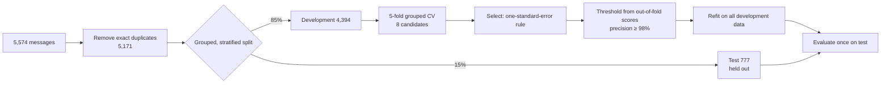

# SMS Spam Classifier

A machine-learning project that classifies SMS messages as **spam** or **ham** (legitimate). It's built to show a careful evaluation process, not just a high accuracy number:
- leakage-free data splitting
- baselines to compare against
- cross-validated model selection
- a decision threshold chosen for the real-world cost of mistakes
- a single, honest test evaluation
- error analysis
- a small prediction API that explains each decision

**Held-out test results** (777 messages the model never saw during development):

| | Precision | Recall | F1 | PR-AUC | Real messages flagged as spam |
|---|---|---|---|---|---|
| **Selected model:** linear SVM on word + character TF-IDF | **0.941** | **0.970** | **0.955** | **0.988** | 6 of 678 (0.88%) |

All metrics treat *spam* as the positive class. Full details are in [reports/REPORT.md](reports/REPORT.md).

## The problem

Spam filters make two kinds of mistakes, and they don't cost the same:
- **A real message flagged as spam** (false positive): you might miss something important from a friend, your bank or your university.
- **Spam that gets through** (false negative): mildly annoying.

So the model's threshold is chosen to keep **precision ≥ 98%**, meaning at most about 2% of flagged messages are real, and to catch as much spam as possible within that.

The data is only 12.6% spam, so **accuracy is misleading**: a "model" that always says *ham* is 87% accurate and useless. This project reports precision, recall, F1 and **PR-AUC**, which together show how well spam is found.

## Data

The [UCI SMS Spam Collection](https://archive.ics.uci.edu/dataset/228/sms+spam+collection) (Almeida & Hidalgo, 2011, CC BY 4.0) contains 5,574 English SMS messages labelled ham or spam.

Before any modelling, I profiled the data, and two findings changed the approach:

1. **403 exact duplicate messages,** all with consistent labels. If they aren't removed, the same message can appear in both training and test data and inflate the scores. After removing them: **5,171 messages, 653 of them spam**.
2. **Near-duplicate spam templates:** 29 groups of messages that differ only in a phone number or prize amount (e.g. *"PRIVATE! Your 2003 Account Statement for 077…"*). The split is **grouped by template**: digits, case and spacing are normalised, and each group goes entirely into one part. A test checks that no template appears in two parts.

The dataset isn't committed to this repo. [`scripts/download_data.py`](scripts/download_data.py) downloads it and verifies its SHA-256 checksum, refusing any file that doesn't match.

## Approach



**Candidates** (scikit-learn), listed simplest first:

| Model | Cross-validated PR-AUC | Precision | Recall | F1 |
|---|---|---|---|---|
| Baseline: always "ham" | 0.126 | 0.126 | 1.000 | 0.224 |
| Baseline: keyword rule (*free, win, prize, txt, call 09…*) | 0.713 ± 0.026 | 0.980 | 0.442 | 0.609 |
| Naive Bayes, word TF-IDF | 0.969 ± 0.004 | 0.980 | 0.901 | 0.939 |
| **Linear SVM, words + characters, C=0.1 (selected)** | **0.983 ± 0.004** | 0.981 | 0.930 | 0.955 |
| Logistic regression, words + characters, C=1 | 0.981 ± 0.004 | 0.981 | 0.919 | 0.949 |
| Linear SVM, words + characters, C=1 | 0.983 ± 0.004 | 0.981 | 0.935 | 0.957 |
| Logistic regression, words + characters, C=10 | 0.982 ± 0.004 | 0.981 | 0.930 | 0.955 |
| Logistic regression, words + characters, C=100 | 0.983 ± 0.004 | 0.981 | 0.939 | 0.959 |

Precision, recall and F1 in this table are at each model's own threshold, measured on out-of-fold predictions.

**Design choices, explained**
- **TF-IDF word 1–2-grams plus character 3–5-grams.** Character n-grams catch spam that disguises words (`FR33`, `txt2win`, `£1000`), which word tokens miss.
- **Class weighting** (`class_weight="balanced"`), so the minority spam class isn't ignored.
- **The one-standard-error rule.** The top five models are within 0.002 PR-AUC of each other, less than the variation between folds (±0.004). Picking the absolute highest would mean choosing on noise, so the rule takes the **simplest model statistically tied with the best**: the strongly regularised SVM, C=0.1.
- **Baselines are for comparison only** and are never selected for deployment. They show what the trained models add: +0.27 PR-AUC over a sensible keyword rule.

## What I changed after the first run (and why)

The first version used a single train/validation/test split and tuned the threshold on the 776-message validation set, which contained only about 98 spam messages. That run is archived in [reports/history/](reports/history/run1-single-validation-split.md).
- **Validation precision was 0.989, but test precision was only 0.914** (9 false positives).
- PR-AUC was stable (0.990 → 0.987), so the model's *ranking* generalised. The **threshold** didn't: it had been fitted to a small, noisy sample.
- Model selection had also picked the *least* regularised model (C=100) by a margin of 0.001.

I switched to 5-fold cross-validation on the development data, so the threshold now comes from 554 out-of-fold spam predictions, and to the one-standard-error rule. Test precision improved to **0.941** with the same recall.

**Caveat:** I had already seen the test results once when I made this change. It was motivated by a methodological flaw, not by tuning to the test set, but the second test result isn't a perfectly untouched estimate. The test precision (0.941) is also still below the 98% target reached in cross-validation (0.981). With only about 100 predicted-spam test messages, 6 false positives instead of 2 is within plausible sampling noise, but I report it as a real gap rather than tuning further on test data.

## Error analysis (test set)

**6 real messages flagged as spam.** Mostly short messages full of words that are common in spam:
- *"Are you free now?can i call now?"*
- *"I liked the new mobile"*
- *"I'm vivek:)i got call from your number."*
- three automated or marketing-like messages (a job-alert notice, a "you've been added to a contact list" notification, a short offer enquiry)

Word-based models struggle with this: *free*, *call* and *mobile* are strong spam signals in this dataset.

**3 spam messages that got through.** Two read like friendly chain messages. One, *"Latest News! Police station toilet stolen, cops have nothing to go on!"*, is labelled spam but looks like a joke, so it's **probably label noise** in the original data.

## Using it

Requires Python 3.11 or newer; developed and tested on 3.14.

```bash
git clone https://github.com/iwan-adler/sms-spam-classifier.git
cd sms-spam-classifier
python -m venv .venv
```
```powershell
.venv\Scripts\Activate.ps1      # Windows PowerShell
```
```bash
source .venv/bin/activate       # macOS / Linux
```
```bash
pip install -r requirements.txt
python scripts/download_data.py           # about 200 KB, checksum-verified
python -m spam_classifier.train           # about 40 s; writes models/ and reports/
uvicorn spam_classifier.api:create_app --factory
```

Then open http://127.0.0.1:8000/docs, or:

```bash
curl -X POST http://127.0.0.1:8000/predict -H "Content-Type: application/json" \
  -d '{"text": "URGENT! You have won a 1 week FREE membership in our £100,000 Prize Jackpot! Txt the word CLAIM to 81010"}'
```
```json
{"label": "spam", "is_spam": true, "score": 1.1842, "score_type": "decision score", "threshold": 0.0282,
 "top_spam_features": [{"feature": "word: txt", "contribution": 0.1378},
                       {"feature": "word: you have", "contribution": 0.0987},
                       {"feature": "word: free", "contribution": 0.0849},
                       {"feature": "word: claim", "contribution": 0.0727},
                       {"feature": "word: won", "contribution": 0.0723}]}
```

| Endpoint | Purpose |
|---|---|
| `POST /predict` | `{"text": "..."}` (1–1000 characters) → label, score, threshold and the features that pushed the score towards spam |
| `GET /model` | Model name, threshold, training date, dataset checksum and test metrics |
| `GET /health` | Whether a trained model is loaded (`/predict` returns `503` if not) |

**About the explanations:** for a linear model, the score is exactly the sum of *(TF-IDF value × learned weight)* over the features present. The API reports the largest positive terms, so the explanation is faithful, not an approximation. Because the selected model is an SVM, the score is a **decision score** (spam if ≥ 0.0282), not a probability.

## Model card

| | |
|---|---|
| **Intended use** | Learning and demonstration; a starting point for flagging likely spam for **human review** |
| **Not intended for** | Deleting messages automatically, or languages other than English (training data is English, mostly from the UK and Singapore, collected around 2011) |
| **Training data** | UCI SMS Spam Collection, deduplicated; 4,394 development messages |
| **Evaluation** | 777 held-out messages: precision 0.941, recall 0.970, F1 0.955, PR-AUC 0.988 |
| **Known weaknesses** | Short real messages containing *free*, *call* or *mobile*; friendly-sounding chain spam; modern spam (links, crypto, delivery scams) isn't represented in 2011 data |
| **Risks** | False positives can hide important messages. Precision on new data may fall below the cross-validated 98% (test: 94%) |

## Tests

```bash
python -m pytest
```

There are 29 tests, which run in about 8 seconds. Almost all use synthetic messages, so they **don't need the dataset**; one test checks the real data's documented counts and is skipped if it isn't downloaded. They cover:
- parsing, including malformed lines
- deduplication and template normalisation
- the split: sizes, stratification, determinism, and **no template in two parts**
- metrics and threshold selection, including the fallback when the precision target can't be reached
- the one-standard-error rule, and that baselines are never selected
- faithful explanations for SVM, logistic regression and Naive Bayes
- end-to-end training and report writing
- the API: predictions, validation, and the 503 response when no model is loaded

To check the leakage test itself, I removed the template grouping from the split, and the test failed.

## Project structure

```
spam_classifier/
  data.py       load, parse, deduplicate, template-grouped stratified split
  models.py     baselines, TF-IDF pipelines, scores, faithful explanations
  evaluate.py   metrics, PR-AUC, threshold selection
  train.py      cross-validation, model selection, test evaluation, reports
  api.py        FastAPI service
scripts/download_data.py   checksum-verified dataset download
reports/                   REPORT.md + metrics.json (committed), history/ (first run)
tests/
```

## Limitations and next steps

- **Old, small dataset.** It's 2011 UK/Singapore SMS. Testing on a newer spam corpus would show how badly it has drifted.
- **Precision below target on test (0.941 vs 0.98).** More data, or a second-stage check for short messages, could help.
- **The score isn't a probability.** Calibration (e.g. `CalibratedClassifierCV`) would make thresholds easier to explain.
- **No transformer baseline yet.** A small fine-tuned model (e.g. DistilBERT) would show whether the extra compute buys accuracy on this data.
- **No handling of links or URLs as features.** That's increasingly important for modern spam.
